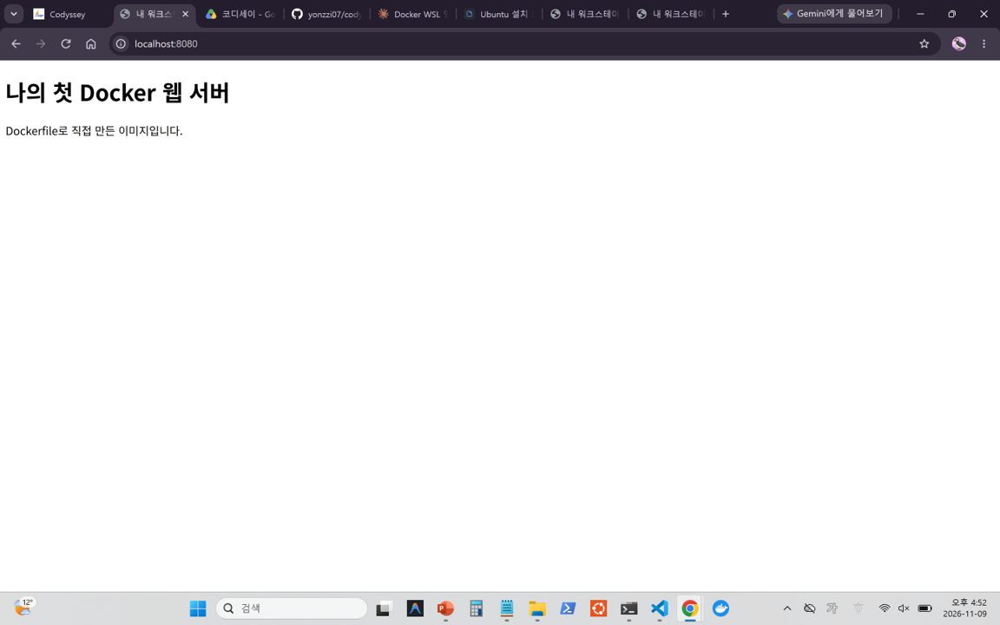
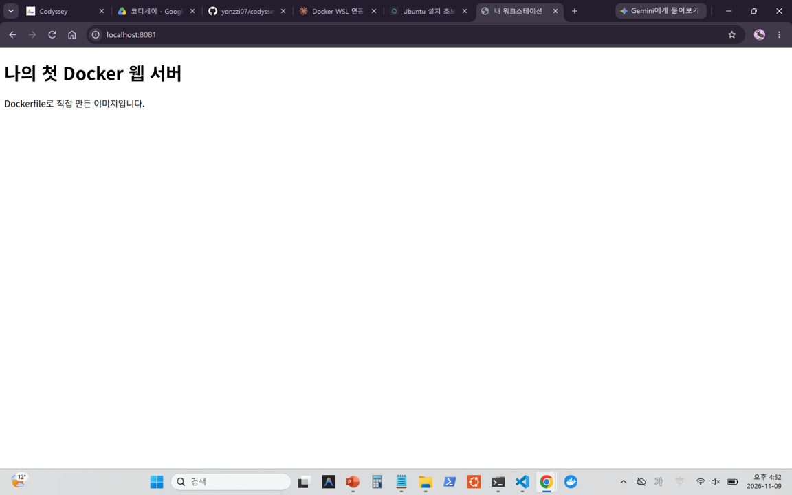
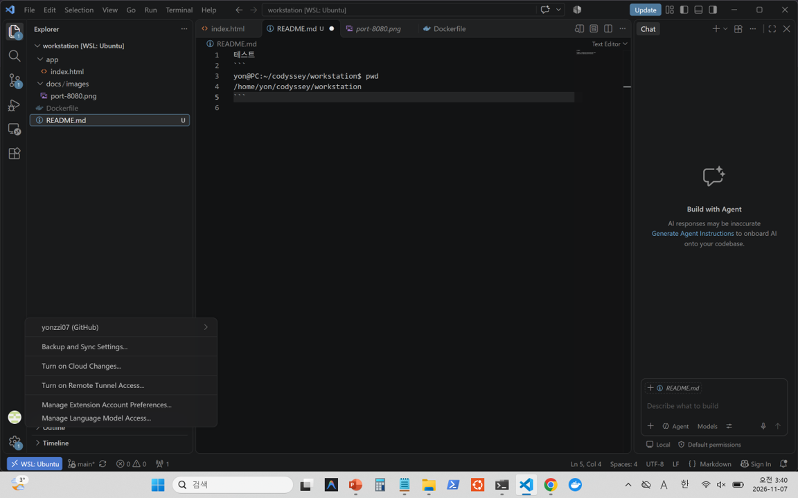
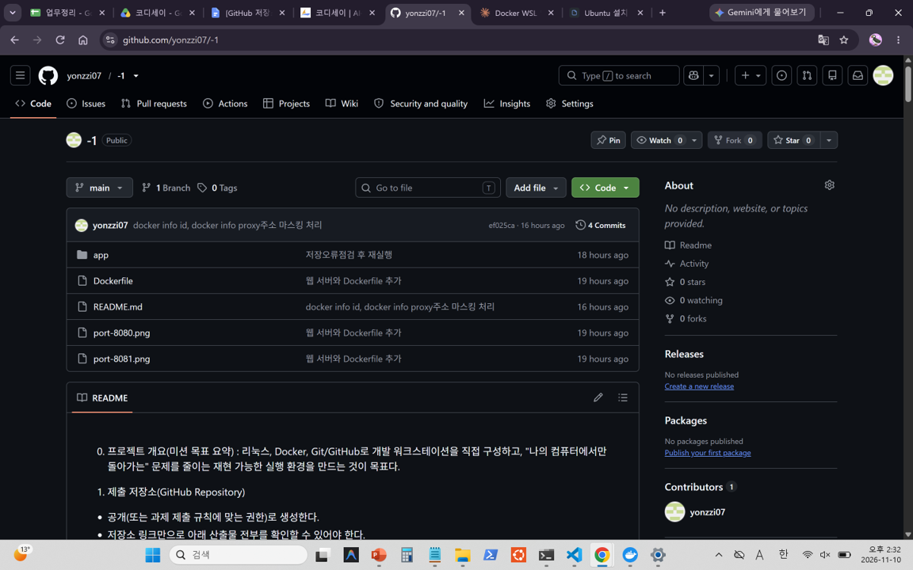

## 0. 프로젝트 개요(미션 목표 요약)
: 리눅스, Docker, Git/GitHub로 개발 워크스테이션을 직접 구성하고,
"나의 컴퓨터에서만 돌아가는" 문제를 줄이는 재현 가능한 실행 환경을 만드는 것이 목표다.

## 1. 실행 환경(OS/쉘/터미널, Docker 버전, Git 버전)

- **OS**
```
yonzzi@BOOK-92VHKBQ8OT:~/codyssey1$ cat /etc/os-release
PRETTY_NAME="Ubuntu 26.04.1 LTS"
NAME="Ubuntu"
VERSION_ID="26.04"
VERSION="26.04.1 LTS (Resolute Raccoon)"
```
```
yonzzi@BOOK-92VHKBQ8OT:~/codyssey1$ uname -r
6.18.54.1-microsoft-standard-WSL2
```

- **쉘**
```
yonzzi@BOOK-92VHKBQ8OT:~/codyssey1$ bash --version
GNU bash, version 5.3.9(1)-release (x86_64-pc-linux-gnu)
```

- **터미널**
```
Windows Terminal, VS Code 통합 터미널
```

- **Docker 버전**
```
yonzzi@BOOK-92VHKBQ8OT:~/codyssey1$ docker --version
Docker version 29.9.2, build a82e528
```

- **Git 버전**
```
yonzzi@BOOK-92VHKBQ8OT:~/codyssey1$ git --version
git version 2.53.0
```

## 2. 수행 항목 체크리스트(터미널/권한/Docker/Dockerfile/포트/볼륨/Git/GitHub)
 : 아래 명시
## 3. 검증 방법(어떤 명령으로 무엇을 확인했는지) + 결과 위치 링크
 : 아래 명시
## 4. 트러블슈팅 2건 이상(문제 → 원인 가설 → 확인 → 해결/대안)
 : 아래 명시

## 5. 터미널 조작 로그
터미널에서 수행한 핵심 명령과 출력 결과를 기술 문서에 기록한다.

### - 현재 위치 확인
```
yonzzi@BOOK-92VHKBQ8OT:~$ pwd
/home/yonzzi
```

### - 폴더 생성 후, 생성한 위치로 이동, 현재위치 확인
```
yonzzi@BOOK-92VHKBQ8OT:~$ mkdir -p ~/codyssey1/practice1
```
```
yonzzi@BOOK-92VHKBQ8OT:~$ cd ~/codyssey1/practice1
```
```
yonzzi@BOOK-92VHKBQ8OT:~/codyssey1/practice1$ pwd
/home/yonzzi/codyssey1/practice1
```
### - 파일 생성(숨김파일), 파일 생성(빈파일), 목록 확인(숨김 파일 제외), 목록 확인(숨김 파일 포함)
```
yonzzi@BOOK-92VHKBQ8OT:~/codyssey1/practice1$ touch .hidden_note
```
```
yonzzi@BOOK-92VHKBQ8OT:~/codyssey1/practice1$ touch empty.txt
```
```
yonzzi@BOOK-92VHKBQ8OT:~/codyssey1/practice1$ ls
empty.txt
```
```
yonzzi@BOOK-92VHKBQ8OT:~/codyssey1/practice1$ ls -la
total 8
drwxr-xr-x 2 yonzzi yonzzi 4096 Nov  7 18:15 .
drwxr-xr-x 3 yonzzi yonzzi 4096 Nov  7 18:12 ..
-rw-r--r-- 1 yonzzi yonzzi    0 Nov  7 18:15 .hidden_note
-rw-r--r-- 1 yonzzi yonzzi    0 Nov  7 18:15 empty.txt
```

### - 파일 내용 확인
```
yonzzi@BOOK-92VHKBQ8OT:~/codyssey1/practice1$ echo "hello" > memo.txt
```
```
yonzzi@BOOK-92VHKBQ8OT:~/codyssey1/practice1$ cat memo.txt
hello
```

### - 파일 복사
```
yonzzi@BOOK-92VHKBQ8OT:~/codyssey1/practice1$ cp memo.txt copy.txt
```
```
yonzzi@BOOK-92VHKBQ8OT:~/codyssey1/practice1$ ls
copy.txt  empty.txt  memo.txt
```

### - 폴더 생성, 파일 이동
```
yonzzi@BOOK-92VHKBQ8OT:~/codyssey1/practice1$ mkdir archive
```
```
yonzzi@BOOK-92VHKBQ8OT:~/codyssey1/practice1$ mv copy.txt archive/
```
```
yonzzi@BOOK-92VHKBQ8OT:~/codyssey1/practice1$ ls archive
copy.txt
```

### - 이름변경
```
yonzzi@BOOK-92VHKBQ8OT:~/codyssey1/practice1$ mv archive/copy.txt archive/renamed.txt
```
```
yonzzi@BOOK-92VHKBQ8OT:~/codyssey1/practice1$ ls archive
renamed.txt
```

### - 삭제
```
yonzzi@BOOK-92VHKBQ8OT:~/codyssey1/practice1$ rm archive/renamed.txt
```
```
yonzzi@BOOK-92VHKBQ8OT:~/codyssey1/practice1$ rmdir archive
```
```
yonzzi@BOOK-92VHKBQ8OT:~/codyssey1/practice1$ ls
empty.txt  memo.txt
```

## 6. 권한 실습 및 증거 기록
### *최소 요구: 파일 1개, 디렉토리 1개에 대해 권한 변경 실험을 수행한다.

## *파일 권한 실습*
### - 권한을 확인 (권한 변경 전)

```
yonzzi@BOOK-92VHKBQ8OT:~/codyssey1/practice1$ touch perm_test.txt
```
```
yonzzi@BOOK-92VHKBQ8OT:~/codyssey1/practice1$ echo "권한 실험" > perm_test.txt
```
```
yonzzi@BOOK-92VHKBQ8OT:~/codyssey1/practice1$ ls -l perm_test.txt
-rw-r--r-- 1 yonzzi yonzzi 14 Nov  7 18:32 perm_test.txt
```

### - 권한을 변경
```
yonzzi@BOOK-92VHKBQ8OT:~/codyssey1/practice1$ chmod 000 perm_test.txt
```
```
yonzzi@BOOK-92VHKBQ8OT:~/codyssey1/practice1$ ls -l perm_test.txt
---------- 1 yonzzi yonzzi 14 Nov  7 18:32 perm_test.txt
```

### - 권한 변경 후
```
yonzzi@BOOK-92VHKBQ8OT:~/codyssey1/practice1$ cat perm_test.txt
cat: perm_test.txt: Permission denied
```

---

## *디렉토리 권한 실습*
### - 권한을 확인 (권한 변경 전)
```
yonzzi@BOOK-92VHKBQ8OT:~/codyssey1/practice1$ mkdir perm_dir
```
```
yonzzi@BOOK-92VHKBQ8OT:~/codyssey1/practice1$ ls -ld perm_dir
drwxr-xr-x 2 yonzzi yonzzi 4096 Nov  7 18:40 perm_dir
```

### - 권한을 변경
```
yonzzi@BOOK-92VHKBQ8OT:~/codyssey1/practice1$ chmod 644 perm_dir
```
```
yonzzi@BOOK-92VHKBQ8OT:~/codyssey1/practice1$ ls -ld perm_dir
drw-r--r-- 2 yonzzi yonzzi 4096 Nov  7 18:40 perm_dir
```

### - 권한 변경 후
```
yonzzi@BOOK-92VHKBQ8OT:~/codyssey1/practice1$ cd perm_dir
bash: cd: perm_dir: Permission denied
```

### - 권한 되돌리기
```
yonzzi@BOOK-92VHKBQ8OT:~/codyssey1/practice1$ chmod 755 perm_dir
```
```
yonzzi@BOOK-92VHKBQ8OT:~/codyssey1/practice1$ ls -ld perm_dir
drwxr-xr-x 2 yonzzi yonzzi 4096 Nov  7 18:40 perm_dir
```
```
yonzzi@BOOK-92VHKBQ8OT:~/codyssey1/practice1$ cd perm_dir
```
```
yonzzi@BOOK-92VHKBQ8OT:~/codyssey1/practice1/perm_dir$ pwd
/home/yonzzi/codyssey1/practice1/perm_dir
```

## 7. Docker 운영/검증 로그
- **docker --version**
```
yonzzi@BOOK-92VHKBQ8OT:~/codyssey1/practice1$ docker --version
Docker version 29.9.2, build a82e528
```

- **docker info 등 설치·점검 결과**
```
yonzzi@BOOK-92VHKBQ8OT:~/codyssey1/practice1$ docker info
Client:
 Version:    29.9.2
 Context:    default
 Debug Mode: false
 Plugins:
  agent: Docker AI Agent Runner (Docker Inc.)
    Version:  v1.152.0
    Path:     /usr/local/lib/docker/cli-plugins/docker-agent
  ai: Docker AI Agent - Ask Gordon (Docker Inc.)
    Version:  v1.33.0
    Path:     /usr/local/lib/docker/cli-plugins/docker-ai
  buildx: Docker Buildx (Docker Inc.)
    Version:  v0.38.1
    Path:     /usr/local/lib/docker/cli-plugins/docker-buildx
  compose: Docker Compose (Docker Inc.)
    Version:  v5.6.1
    Path:     /usr/local/lib/docker/cli-plugins/docker-compose
  debug: Get a shell into any image or container (Docker Inc.)
    Version:  0.49.0
    Path:     /usr/local/lib/docker/cli-plugins/docker-debug
  desktop: Docker Desktop commands (Docker Inc.)
    Version:  4.98.0
    Path:     /usr/local/lib/docker/cli-plugins/docker-desktop
  dhi: CLI for managing Docker Hardened Images (Docker Inc.)
    Version:  v0.0.9
    Path:     /usr/local/lib/docker/cli-plugins/docker-dhi
  extension: Manages Docker extensions (Docker Inc.)
    Version:  v0.2.32
    Path:     /usr/local/lib/docker/cli-plugins/docker-extension
  init: Creates Docker-related starter files for your project (Docker Inc.)
    Version:  v1.4.1
    Path:     /usr/local/lib/docker/cli-plugins/docker-init
  mcp: Docker MCP Plugin (Docker Inc.)
    Version:  v0.44.2
    Path:     /usr/local/lib/docker/cli-plugins/docker-mcp
  model: Docker Model Runner (Docker Inc.)
    Version:  v1.2.9
    Path:     /usr/local/lib/docker/cli-plugins/docker-model
  offload: Docker Offload (Docker Inc.)
    Version:  v0.7.35
    Path:     /usr/local/lib/docker/cli-plugins/docker-offload
  pass: Docker Pass Secrets Manager Plugin (beta) (Docker Inc.)
    Version:  v0.3.2
    Path:     /usr/local/lib/docker/cli-plugins/docker-pass
  sandbox: "docker sandbox" is deprecated, use Docker Sandboxes instead (Docker Inc.)
    Version:  v0.13.0
    Path:     /usr/local/lib/docker/cli-plugins/docker-sandbox
  scout: Docker Scout (Docker Inc.)
    Version:  v1.27.0
    Path:     /usr/local/lib/docker/cli-plugins/docker-scout

Server:
 Containers: 2
  Running: 0
  Paused: 0
  Stopped: 2
 Images: 5
 Server Version: 29.9.2
 Storage Driver: overlayfs
  driver-type: io.containerd.snapshotter.v1
 Logging Driver: local
 Cgroup Driver: cgroupfs
 Cgroup Version: 2
 Plugins:
  Volume: local
  Network: bridge host ipvlan macvlan null overlay
  Log: awslogs fluentd gcplogs gelf journald json-file local splunk syslog
 CDI spec directories:
  /etc/cdi
  /var/run/cdi
 Discovered Devices:
  cdi: docker.com/gpu=webgpu
 Swarm: inactive
 Runtimes: io.containerd.runc.v2 nvidia runc
 Default Runtime: runc
 Init Binary: docker-init
 containerd version: b7a25261e029d68978bbf290df0a62fc819b3c51
 runc version: v1.5.2-0-g29dd3dc2
 init version: de40ad0
 Security Options:
  seccomp
   Profile: builtin
  cgroupns
 Kernel Version: 6.18.54.1-microsoft-standard-WSL2
 Operating System: Docker Desktop
 OSType: linux
 Architecture: x86_64
 CPUs: 8
 Total Memory: 15.38GiB
 Name: docker-desktop
 ID: 00000000-0000-0000-0000-000000000000
 Docker Root Dir: /var/lib/docker
 Debug Mode: false
 HTTP Proxy: http.docker.internal:0000
 HTTPS Proxy: http.docker.internal:0000 
 No Proxy: hubproxy.docker.internal
 Labels:
  com.docker.desktop.address=unix:///var/run/docker-cli.sock
 Experimental: false
 Insecure Registries:
  hubproxy.docker.internal:5555
  127.0.0.0/8
  ::1/128
 Live Restore Enabled: false
 Firewall Backend: iptables
```

- **docker images**
```
yonzzi@BOOK-92VHKBQ8OT:~/codyssey1/practice1$ docker images
```
```
IMAGE                ID             DISK USAGE   CONTENT SIZE   EXTRA
hello-world:latest   c567b231f656       25.9kB         9.49kB    U
my-web:1.0           315b815f656b       93.7MB         26.4MB    U
nginx:alpine         713fc2ebfd92       94.5MB         27.3MB    U
ubuntu:latest        6a06111c3b0a        163MB         45.9MB    U
```

- **docker ps**
```
yonzzi@BOOK-92VHKBQ8OT:~/codyssey1/practice1$ docker ps
CONTAINER ID   IMAGE          COMMAND                  CREATED         STATUS         PORTS     NAMES
6b232347bba6   nginx:alpine   "/docker-entrypoint.…"   7 minutes ago   Up 7 minutes   80/tcp    test-nginx
```

- **docker ps -a**
```
yonzzi@BOOK-92VHKBQ8OT:~/codyssey1/practice1$ docker stop test-nginx
test-nginx
```
```
yonzzi@BOOK-92VHKBQ8OT:~/codyssey1/practice1$ docker ps
CONTAINER ID   IMAGE     COMMAND   CREATED   STATUS    PORTS     NAMES
```
```
yonzzi@BOOK-92VHKBQ8OT:~/codyssey1/practice1$ docker ps -a
CONTAINER ID   IMAGE          COMMAND                  CREATED          STATUS                     PORTS     NAMES
6b232347bba6   nginx:alpine   "/docker-entrypoint.…"   16 minutes ago   Exited (0) 2 minutes ago             test-nginx
```

- **docker logs**
```
yonzzi@BOOK-92VHKBQ8OT:~/codyssey1/practice1$ docker logs test-nginx
/docker-entrypoint.sh: /docker-entrypoint.d/ is not empty, will attempt to perform configuration
/docker-entrypoint.sh: Looking for shell scripts in /docker-entrypoint.d/
/docker-entrypoint.sh: Launching /docker-entrypoint.d/10-listen-on-ipv6-by-default.sh
10-listen-on-ipv6-by-default.sh: info: Getting the checksum of /etc/nginx/conf.d/default.conf
10-listen-on-ipv6-by-default.sh: info: Enabled listen on IPv6 in /etc/nginx/conf.d/default.conf
/docker-entrypoint.sh: Sourcing /docker-entrypoint.d/15-local-resolvers.envsh
/docker-entrypoint.sh: Launching /docker-entrypoint.d/20-envsubst-on-templates.sh
/docker-entrypoint.sh: Launching /docker-entrypoint.d/30-tune-worker-processes.sh
/docker-entrypoint.sh: Configuration complete; ready for start up
2026/11/07 10:21:14 [notice] 1#1: using the "epoll" event method
2026/11/07 10:21:14 [notice] 1#1: nginx/1.31.8
2026/11/07 10:21:14 [notice] 1#1: built by gcc 15.2.0 (Alpine 15.2.0)
2026/11/07 10:21:14 [notice] 1#1: OS: Linux 6.18.54.1-microsoft-standard-WSL2
2026/11/07 10:21:14 [notice] 1#1: getrlimit(RLIMIT_NOFILE): 1048576:1048576
2026/11/07 10:21:14 [notice] 1#1: start worker processes
2026/11/07 10:21:14 [notice] 1#1: start worker process 30
2026/11/07 10:21:14 [notice] 1#1: start worker process 31
2026/11/07 10:21:14 [notice] 1#1: start worker process 32
2026/11/07 10:21:14 [notice] 1#1: start worker process 33
2026/11/07 10:21:14 [notice] 1#1: start worker process 34
2026/11/07 10:21:14 [notice] 1#1: start worker process 35
2026/11/07 10:21:14 [notice] 1#1: start worker process 36
2026/11/07 10:21:14 [notice] 1#1: start worker process 37
```

- **docker stats 등 운영 명령 실행 흔적**
```
yonzzi@BOOK-92VHKBQ8OT:~/codyssey1/practice1$ docker stats --no-stream
CONTAINER ID   NAME         CPU %     MEM USAGE / LIMIT     MEM %     NET I/O         BLOCK I/O     PIDS
6b232347bba6   test-nginx   0.00%     7.328MiB / 15.38GiB   0.05%     1.17kB / 126B   0B / 12.3kB   9
```

## 8. Dockerfile 기반 웹 서버 컨테이너
- 웹 서버 소스코드
- Dockerfile
- 빌드/실행 명령 및 결과 로그(터미널 스크린샷 가능)
- 포트 매핑 접속 성공 증거(스크린샷 또는 로그)


### 컨테이너 실행 실습

- **hello-world 실행 성공**
```
Unable to find image 'hello-world:latest' locally
latest: Pulling from library/hello-world
4f55086f7dd0: Pull complete
d5e71e642bf5: Download complete
Digest: sha256:c567b231f65614688711a75f31518a064258a51d442117a3e771a3a8fdba78ef
Status: Downloaded newer image for hello-world:latest

Hello from Docker!
This message shows that your installation appears to be working correctly.
	
To generate this message, Docker took the following steps:
 1. The Docker client contacted the Docker daemon.
 2. The Docker daemon pulled the "hello-world" image from the Docker Hub.
    (amd64)
 3. The Docker daemon created a new container from that image which runs the
    executable that produces the output you are currently reading.
 4. The Docker daemon streamed that output to the Docker client, which sent it
    to your terminal.

To try something more ambitious, you can run an Ubuntu container with:
 $ docker run -it ubuntu bash

Share images, automate workflows, and more with a free Docker ID:
 https://hub.docker.com/

For more examples and ideas, visit:
 https://docs.docker.com/get-started/
```


- **ubuntu 컨테이너를 실행**

```
yonzzi@BOOK-92VHKBQ8OT:~/codyssey1/practice1$ docker run -it --name my-ubuntu ubuntu bash
```
```
Unable to find image 'ubuntu:latest' locally
latest: Pulling from library/ubuntu
f3f25b84a7d7: Pull complete
edafa32f5d9e: Pull complete
21594acc2d8b: Download complete
Digest: sha256:6a06111c3b0a8600feadb270aec771dc239bf407b25625f93f44ab00e11f4d3c
Status: Downloaded newer image for ubuntu:latest
```

- **내부 진입 후 간단 명령(ls, echo) 수행 결과를 기록**
*기존 `my-ubuntu` 컨테이너를 시작하며 내부로 진입한 뒤, `ls`와 `echo`를 실행했다.*

```
yonzzi@BOOK-92VHKBQ8OT:~/codyssey1/practice1$ docker start -ai my-ubuntu
```
```
root@8784dba703ff:/# ls
bin  boot  dev  etc  home  lib  lib64  media  mnt  opt  proc  root  run  sbin  srv  sys  tmp  usr  var
```
```
root@8784dba703ff:/# export LANG=C.UTF-8
```
```
root@8784dba703ff:/# echo "컨테이너 안입니다"
컨테이너 안입니다
```
```
root@8784dba703ff:/# exit
exit
```

- **컨테이너 종료/유지(attach/exec 등) 차이 정리**


  **[컨테이너 종료 상태인 점 확인]**
```
yonzzi@BOOK-92VHKBQ8OT:~/codyssey1/practice1$ docker ps -a
```
```
CONTAINER ID   IMAGE          COMMAND                  CREATED        STATUS                     PORTS     NAMES
8784dba703ff   ubuntu         "bash"                   44 hours ago   Exited (0) 3 minutes ago             my-ubuntu
5a059ec42753   hello-world    "/hello"                 44 hours ago   Exited (0) 44 hours ago              hopeful_wiles
6b232347bba6   nginx:alpine   "/docker-entrypoint.…"   44 hours ago   Exited (0) 44 hours ago              test-nginx
```

*멈춘 컨테이너를 다시 켰습니다.*

```
yonzzi@BOOK-92VHKBQ8OT:~/codyssey1/practice1$ docker start my-ubuntu
my-ubuntu
```
```
yonzzi@BOOK-92VHKBQ8OT:~/codyssey1/practice1$ docker ps
CONTAINER ID   IMAGE     COMMAND   CREATED        STATUS          PORTS     NAMES
8784dba703ff   ubuntu    "bash"    44 hours ago   Up 11 seconds             my-ubuntu
```
*exec로 들어갔다가 exit로 나왔는데도, my-ubuntu가 계속 실행 중*
*exec로 연 bash는 추가로 연 작업이라, 끝내도 컨테이너의 주 프로그램(처음 시작한 bash)은 그대로 살아 있습니다. 그래서 STATUS가 Up으로 유지.*
```
yonzzi@BOOK-92VHKBQ8OT:~/codyssey1/practice1$ docker exec -it my-ubuntu bash
```
```
root@8784dba703ff:/# exit
exit
```
```
yonzzi@BOOK-92VHKBQ8OT:~/codyssey1/practice1$ docker ps
CONTAINER ID   IMAGE     COMMAND   CREATED        STATUS              PORTS     NAMES
8784dba703ff   ubuntu    "bash"    44 hours ago   Up About a minute             my-ubuntu
```

  **[attach로 직접 연결]**
```
yonzzi@BOOK-92VHKBQ8OT:~/codyssey1/practice1$ docker attach my-ubuntu
```
```
root@8784dba703ff:/# exit
exit
```

```
yonzzi@BOOK-92VHKBQ8OT:~/codyssey1/practice1$ docker ps -a
CONTAINER ID   IMAGE          COMMAND                  CREATED        STATUS                     PORTS     NAMES
8784dba703ff   ubuntu         "bash"                   44 hours ago   Exited (0) 6 seconds ago             my-ubuntu
5a059ec42753   hello-world    "/hello"                 44 hours ago   Exited (0) 44 hours ago              hopeful_wiles
6b232347bba6   nginx:alpine   "/docker-entrypoint.…"   44 hours ago   Exited (0) 44 hours ago              test-nginx
```


- **기존 Dockerfile 기반 커스텀 이미지 제작**

1. 어떤 “기존 베이스(이미지/예시 Dockerfile)”를 선택했는지
: nginx:alpine
2. 내가 적용한 커스텀 포인트 각각의 목적(간단 요약)
: 웹서버(NGINX)가 이미 설치,설정되어 있어서 정적 콘텐츠만 교체하면 바로 웹서버로 동작한다.
: NGINX 기본 페이지 대신 직접 작성한 app/index.html을 웹 루트에 넣어서 내 페이지를 보여줌.
3. 빌드

*웹 서버 베이스 이미지 활용(NGINX) + 정적 콘텐츠/설정만 교체
```
yonzzi@BOOK-92VHKBQ8OT:~/codyssey1/workstation1$ cd ~/codyssey1/workstation1
```
```
yonzzi@BOOK-92VHKBQ8OT:~/codyssey1/workstation1$ docker build -t my-web:1.0 .
```
```
[+] Building 0.6s (7/7) FINISHED                                                                                       docker:default
 => [internal] load build definition from Dockerfile                                                                             0.0s
 => => transferring dockerfile: 108B                                                                                             0.0s
 => [internal] load metadata for docker.io/library/nginx:alpine                                                                  0.1s
 => [internal] load .dockerignore                                                                                                0.1s
 => => transferring context: 2B                                                                                                  0.0s
 => [internal] load build context                                                                                                0.0s
 => => transferring context: 60B                                                                                                 0.0s
 => [1/2] FROM docker.io/library/nginx:alpine@sha256:713fc2ebfd92e8217db451477182ee91944b123d2b1ee9fd5a8c6e91ca6c3a11            0.1s
 => => resolve docker.io/library/nginx:alpine@sha256:713fc2ebfd92e8217db451477182ee91944b123d2b1ee9fd5a8c6e91ca6c3a11            0.0s
 => [2/2] COPY app/index.html /usr/share/nginx/html/index.html                                                                   0.0s
 => exporting to image                                                                                                           0.2s
 => => exporting layers                                                                                                          0.1s
 => => exporting manifest sha256:3c117e7ee22cd7a6baca88dc81213d305158fdfd1746f9ad5b5b9d12ac1fe0fe                                0.0s
 => => exporting config sha256:011cf7b64716b9d8a7e01fbe71bffb5b003fd4561e2d7191982325195b9a6347                                  0.0s
 => => exporting attestation manifest sha256:7f4f11f32f5dc5a3a83733f771f275cb4c54e4e25fdb2a86250a0f047a1d5e5b                    0.0s
 => => exporting manifest list sha256:df27d1d46bcd635896b9d5602473829beb4ef516618480638a43e83e80849072                           0.0s
 => => naming to docker.io/library/my-web:1.0                                                                                    0.0s
 => => unpacking to docker.io/library/my-web:1.0           
```


## 9. 포트 매핑 접속 증거
- p <host_port>:<container_port>로 실행 후, 브라우저 접속 화면(주소창 포함)을 기술 문서에 첨부한다.
- 브라우저 접속 화면(또는 curl 응답)

**[Localhost:8081]**
```
yonzzi@BOOK-92VHKBQ8OT:~/codyssey1/workstation1$ curl http://localhost:8080
```
```
<!doctype html>
<html lang="ko">
<head>
  <meta charset="utf-8">
  <title>내 워크스테이션</title>
</head>
<body>
  <h1>나의 첫 Docker 웹 서버</h1>
  <p>Dockerfile로 직접 만든 이미지입니다.</p>
</body>
```


**[Localhost:8081]**
```
yonzzi@BOOK-92VHKBQ8OT:~/codyssey1/workstation1$ curl http://localhost:8081
<!doctype html>
<html lang="ko">
<head>
  <meta charset="utf-8">
  <title>내 워크스테이션</title>
</head>
<body>
  <h1>나의 첫 Docker 웹 서버</h1>
  <p>Dockerfile로 직접 만든 이미지입니다.</p>
</body>
```


## 10. 트러블슈팅
### Case 1
```
curl http://localhost:8080
```
- 실행했으나 터미널에 아무것도 보여지지 않았음.
- curl -i 실행 시 content-length 0으로 확인.
- VScode에서 app/index.html이 저장되지 않았음을 확인하여 저장.
- 이미지는 빌드 시점의 복사본이라 파일을 고쳐도 반영되지 않았음.
- Ubuntu 터미널에서 다시 아래 명령 실행하여 app/index.html 내용이 정상적으로 불러와지는지 확인 완료.
```
yonzzi@BOOK-92VHKBQ8OT:~/codyssey1/workstation1$ cat ~/codyssey1/workstation1/app/index.html
```
```
<!doctype html>
<html lang="ko">
<head>
  <meta charset="utf-8">
  <title>내 워크스테이션</title>
</head>
<body>
  <h1>나의 첫 Docker 웹 서버</h1>
  <p>Dockerfile로 직접 만든 이미지입니다.</p>
</body>
```

- Dockerfile로 이미지 다시 만들었음.
- 수정한 index.html을 이미지에 반영하기 위해, Dockerfile로 이미지를 다시 빌드.
```
</html> yonzzi@BOOK-92VHKBQ8OT:~/codyssey1/workstation1$ docker build -t my-web:1.0 .
```
```
[+] Building 0.3s (7/7) FINISHED                                                                                       docker:default
 => [internal] load build definition from Dockerfile                                                                             0.0s
 => => transferring dockerfile: 403B                                                                                             0.0s
 => [internal] load metadata for docker.io/library/nginx:alpine                                                                  0.0s
 => [internal] load .dockerignore                                                                                                0.0s
 => => transferring context: 2B                                                                                                  0.0s
 => [internal] load build context                                                                                                0.0s
 => => transferring context: 303B                                                                                                0.0s
 => CACHED [1/2] FROM docker.io/library/nginx:alpine@sha256:713fc2ebfd92e8217db451477182ee91944b123d2b1ee9fd5a8c6e91ca6c3a11     0.0s
 => => resolve docker.io/library/nginx:alpine@sha256:713fc2ebfd92e8217db451477182ee91944b123d2b1ee9fd5a8c6e91ca6c3a11            0.0s
 => [2/2] COPY app/ /usr/share/nginx/html/                                                                                       0.0s
 => exporting to image                                                                                                           0.1s
 => => exporting layers                                                                                                          0.0s
 => => exporting manifest sha256:268161520276b1768d3d8dd7b7f6dcbc6cd096b64c23484bf5e20b7a62c127e0                                0.0s
 => => exporting config sha256:a6e1da28f1c1b934e2ae18cd64d73e6b1620482ec9df85d56a9f21cdd6946760                                  0.0s
 => => exporting attestation manifest sha256:d93fac82f5c154d4acdf50ce00cc755d43efcee9151685724d5d416502b32062                    0.0s
 => => exporting manifest list sha256:315b815f656b7a5e53095082fb70b5cf9eb4eeae30f59207949c34fdc958811f                           0.0s
 => => naming to docker.io/library/my-web:1.0                                                                                    0.0s
 => => unpacking to docker.io/library/my-web:1.0                                                                                 0.0s
```

- 기존꺼 컨테이너 삭제
```
yonzzi@BOOK-92VHKBQ8OT:~/codyssey1/workstation1$ docker rm -f my-web-8080 
my-web-8081
my-web-8080
my-web-8081
```

- 최종 저장한 my-web:1.0 이미지로 컨테이너 새로 생성 & 실행
- 내 PC의 8080번 포트, 내 PC의 8081 포트로 들어온 요청을 컨테이너 안 NGINX의 80번 포트로 전달
```
yonzzi@BOOK-92VHKBQ8OT:~/codyssey1/workstation1$ docker run -d -p 8080:80 --name my-web-8080 my-web:1.0
31e1078fbbc5221a4a6ea815a2af82a0d67d23c0ad803c635685684c94ab5ecf
```
```
yonzzi@BOOK-92VHKBQ8OT:~/codyssey1/workstation1$ docker run -d -p 8081:80 --name my-web-8081 my-web:1.0
80202dbd24bb8d7e6e3aa1829ca3f4a02e74b6879357eb889dd5490e16146b00
```


### Case 2
- 맨 앞의 /는 Ubuntu의 가장 꼭대기 폴더부터 찾으라는 뜻이라 파일을 찾을 수 없다고 보여짐.
```
yonzzi@BOOK-92VHKBQ8OT:~/codyssey1/workstation1$ cat /app/index.html
cat: /app/index.html: No such file or directory
```
- 경로 수정
```
yonzzi@BOOK-92VHKBQ8OT:~/codyssey1/workstation1$ cat ~/codyssey1/workstation1/app/index.html
```
```
<!doctype html>
<html lang="ko">
<head>
  <meta charset="utf-8">
  <title>내 워크스테이션</title>
</head>
<body>
  <h1>나의 첫 Docker 웹 서버</h1>
  <p>Dockerfile로 직접 만든 이미지입니다.</p>
</body>
</html>
```


## 11. 바인드 마운트 반영 + 볼륨 영속성 증거
- 바인드 마운트: 실행 명령
- 호스트의 app 폴더를 컨테이너의 NGINX 웹 폴더에 연결.
```
yonzzi@BOOK-92VHKBQ8OT:~/codyssey1/workstation1$ docker run -d -p 8082:80 --name my-web-bind -v "$(pwd)/app:/usr/share/nginx/html" nginx:alpine
24b27f0649fe448b82ceb5a0214bb4716b2b383c87dacf5d1ddc6caae950eab7
```

- 바인드 마운트: 호스트 변경 전 (포트 8082)
```
yonzzi@BOOK-92VHKBQ8OT:~/codyssey1/workstation1$ curl http://localhost:8082
```
```
<!doctype html>
<html lang="ko">
<head>
  <meta charset="utf-8">
  <title>내 워크스테이션</title>
</head>
<body>
  <h1>나의 첫 Docker 웹 서버</h1>
  <p>Dockerfile로 직접 만든 이미지입니다.</p>
</body>
</html>
```

- 바인드 마운트: 호스트 변경 후 (포트 8082)
```
yonzzi@BOOK-92VHKBQ8OT:~/codyssey1/workstation1$ echo "<p>바인드 마운트로 추가한 문장</p>" >> app/index.html
```
```
yonzzi@BOOK-92VHKBQ8OT:~/codyssey1/workstation1$ curl http://localhost:8082
<!doctype html>
<html lang="ko">
<head>
  <meta charset="utf-8">
  <title>내 워크스테이션</title>
</head>
<body>
  <h1>나의 첫 Docker 웹 서버</h1>
  <p>Dockerfile로 직접 만든 이미지입니다.</p>
</body>
</html> <p>바인드 마운트로 추가한 문장</p>
```
! **비교 - 포트8080**
- 커스텀 이미지로 만든 컨테이너에 연결한 포트이므로 기존 내용 유지.
- 빌드 시점에 이미지 안에 복사한 파일을 사용하므로, 호스트 파일을 수정해도 내용 변경되지 않았음.
```
yonzzi@BOOK-92VHKBQ8OT:~/codyssey1/workstation1$ curl http://localhost:8080
```
```
<!doctype html>
<html lang="ko">
<head>
  <meta charset="utf-8">
  <title>내 워크스테이션</title>
</head>
<body>
  <h1>나의 첫 Docker 웹 서버</h1>
  <p>Dockerfile로 직접 만든 이미지입니다.</p>
</body>
</html>
```

- Docker 볼륨

**[생성]**
```
</html> yonzzi@BOOK-92VHKBQ8OT:~/codyssey1/workstation1$ docker volume create my-volume
my-volume
```
```
yonzzi@BOOK-92VHKBQ8OT:~/codyssey1/workstation1$ docker volume ls
DRIVER    VOLUME NAME
local     my-volume
```

**[연결]**
```
yonzzi@BOOK-92VHKBQ8OT:~/codyssey1/workstation1$ docker run -d --name vol-test -v my-volume:/data ubuntu sleep infinity
a8a325ccb3bd2351e7e8f09af899a622d78e820144d8c4b0cb884f6e1f2eccd9
```

**[검증 명령 / 컨테이너 삭제 전]**
```
yonzzi@BOOK-92VHKBQ8OT:~/codyssey1/workstation1$ docker exec vol-test bash -c "echo 나의기록 > /data/hello.txt"
```
```
yonzzi@BOOK-92VHKBQ8OT:~/codyssey1/workstation1$ docker exec vol-test cat /data/hello.txt
나의기록
```

**[컨테이너 삭제 후 비교]**
#### vol-test 컨테이너 삭제해서, 리스트에 없음.
```
yonzzi@BOOK-92VHKBQ8OT:~/codyssey1/workstation1$ docker rm -f vol-test
vol-test
```
```
yonzzi@BOOK-92VHKBQ8OT:~/codyssey1/workstation1$ docker ps -a
CONTAINER ID   IMAGE          COMMAND                  CREATED          STATUS                    PORTS                                     NAMES
24b27f0649fe   nginx:alpine   "/docker-entrypoint.…"   40 minutes ago   Up 40 minutes             0.0.0.0:8082->80/tcp, [::]:8082->80/tcp   my-web-bind
80202dbd24bb   my-web:1.0     "/docker-entrypoint.…"   2 hours ago      Up 2 hours                0.0.0.0:8081->80/tcp, [::]:8081->80/tcp   my-web-8081
31e1078fbbc5   my-web:1.0     "/docker-entrypoint.…"   2 hours ago      Up 2 hours                0.0.0.0:8080->80/tcp, [::]:8080->80/tcp   my-web-8080
```

#### 새 컨테이너(vol-test2)에 같은 볼륨을 연결했고, '나의 기록' 문구가 화면에 보여지므로 데이터 유지되었음을 검증 완료.
```
yonzzi@BOOK-92VHKBQ8OT:~/codyssey1/workstation1$ docker run -d --name vol-test2 -v my-volume:/data ubuntu sleep infinity
```
```
e085bfbfec42fe2eea90e7b36eb1b915261a684ef34fed72759863bed0ddb1dc
```
```
yonzzi@BOOK-92VHKBQ8OT:~/codyssey1/workstation1$ docker exec vol-test2 cat /data/hello.txt
```
```
나의기록
```

## 11. Git 설정 및 GitHub/VSCode 연동 증거

- Git 사용자 정보·기본 브랜치 설정 후, git config --list 결과를 기록한다.
```
yonzzi@BOOK-92VHKBQ8OT:~/codyssey1/workstation1$ git config --global init.defaultBranch main
```
```
yonzzi@BOOK-92VHKBQ8OT:~/codyssey1/workstation1$ git config --list
user.name=yonzzi07
user.email=351367886+yonzzi07@users.noreply.github.com
init.defaultbranch=main
```

- VSCode에서 GitHub 로그인 및 저장소 연동 완료 후 연동 증거를 첨부한다.

